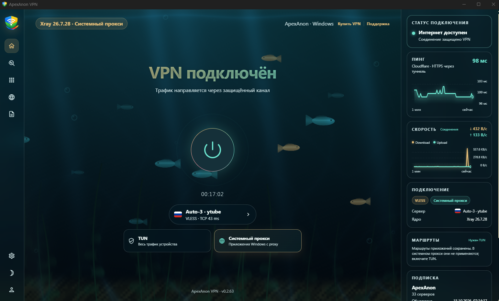
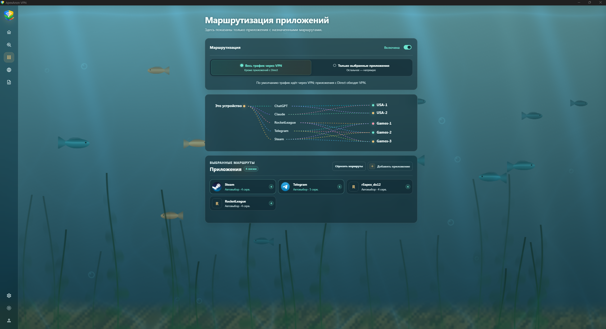
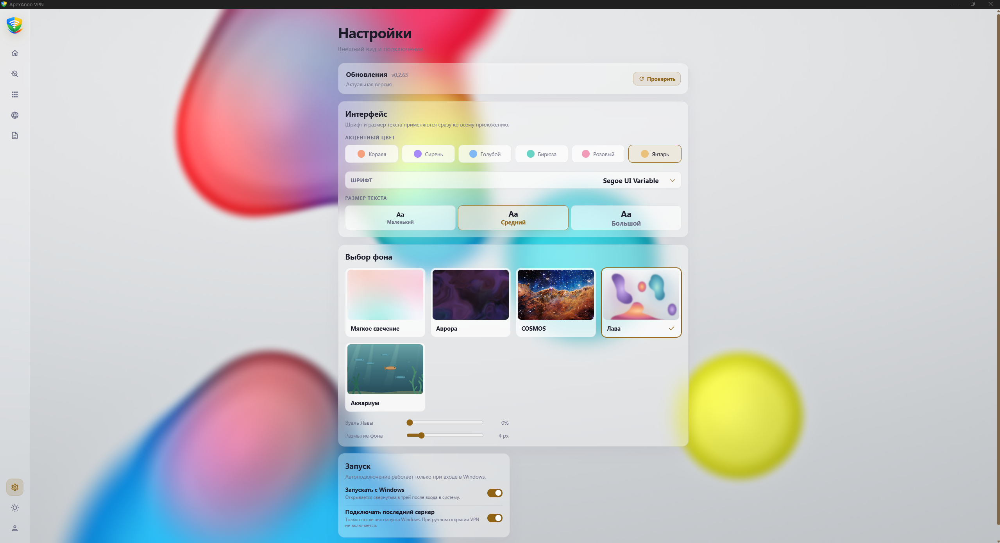
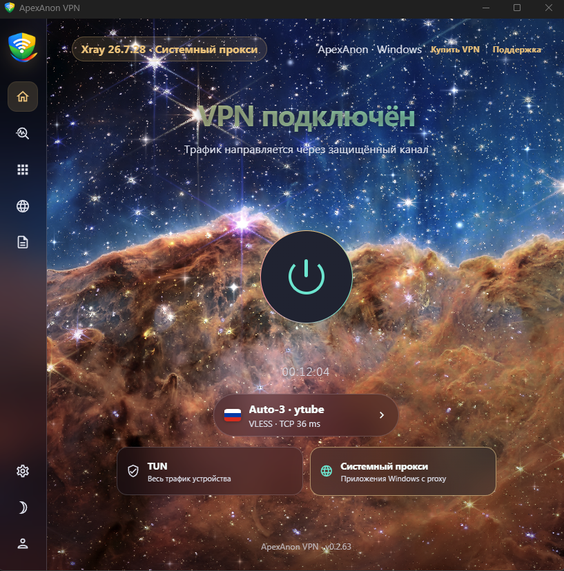
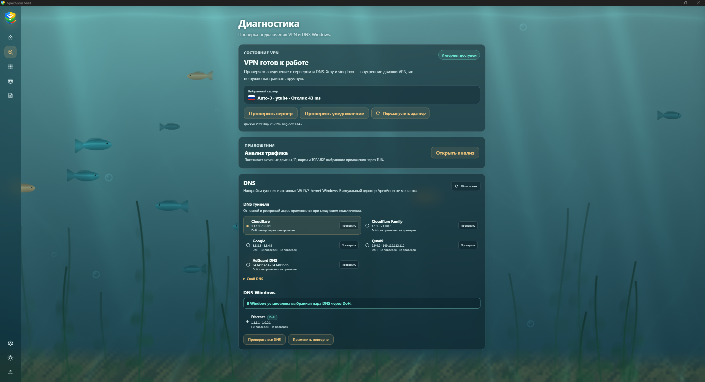

# ApexAnon VPN

**Современное VPN-приложение для Windows — красивое снаружи, гибкое в настройках и удобное каждый день.**

Подключайте всё устройство или только нужные приложения, выбирайте серверы
и настраивайте маршруты для сайтов. Основные действия — на одном экране,
а оформление можно подобрать под себя.

**[Скачать для Windows](https://github.com/vonabe/ApexAnon/releases/latest)** · **[Сайт](https://apexanon.space)** · **[Telegram-бот](https://t.me/ApexAnonBot)**

### Всё важное — перед глазами

Подключение одной кнопкой, выбранный сервер, время сеанса и переключение между
TUN и системным прокси. На боковой панели — статус соединения, пинг и графики
трафика. Можно быстро оценить работу VPN, не открывая дополнительные окна.

## Свой маршрут для каждого приложения

Направляйте нужные программы через VPN, оставляйте другие работать напрямую
или выбирайте несколько серверов для автоматического выбора. Используйте VPN
для всего устройства с исключениями либо только для выбранных приложений.
Наглядная схема помогает видеть назначенные маршруты.

## Выбор сервера без лишних действий

Сравнивайте задержку, фильтруйте серверы по типу подключения и показывайте
только доступные. Выбирайте локацию вручную или доверьте выбор режиму «Авто».

## Интерфейс, который можно сделать своим

Светлая и тёмная темы, акцентные цвета, разные фоны, выбор шрифта и размера
текста. От спокойного свечения до аквариума и космического пейзажа — настройте
приложение так, чтобы им было приятно пользоваться.

<strong>Посмотреть оформление COSMOS</strong>

  

## Диагностика под рукой

Проверяйте доступность сервера, выбирайте DNS и смотрите состояние подключения
в одном разделе. Анализ трафика помогает разобраться, какие соединения
используют приложения, а журнал событий — найти причину неполадки.

## Ещё больше удобства

- **Правила для сайтов:** отдельные маршруты для доменов и IP-адресов.
- **Два режима работы:** туннель TUN и системный прокси под разные задачи.
- **Автозапуск:** открытие в трее при входе в Windows и подключение последнего сервера при включённой настройке.
- **Обновления в фоне:** новая версия скачивается автоматически и устанавливается по кнопке или при следующем запуске.

## Как начать

1. Получите подписку в **[ApexAnonBot](https://t.me/ApexAnonBot)**.
2. Скачайте EXE-установщик из **[последнего релиза](https://github.com/vonabe/ApexAnon/releases/latest)** и установите приложение.
3. Добавьте ссылку на подписку, выберите сервер или режим «Авто» и нажмите «Подключить».

## Ссылки

- **Сайт:** [apexanon.space](https://apexanon.space)
- **Подписка и управление доступом:** [@ApexAnonBot](https://t.me/ApexAnonBot)
- **Скачать приложение:** [последняя версия для Windows](https://github.com/vonabe/ApexAnon/releases/latest)

## Лицензия

Оригинальные материалы ApexAnon защищены [проприетарной лицензией](LICENSE).
Использование официального приложения разрешено; изменение и распространение
оригинальных материалов требуют письменного разрешения правообладателя.
Сторонние компоненты сохраняют [свои лицензии и права](THIRD_PARTY_NOTICES.md).
